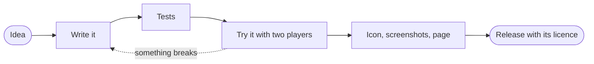

<picture>
  <source media="(prefers-color-scheme: dark)" srcset="assets/banner-dark.svg">
  <source media="(prefers-color-scheme: light)" srcset="assets/banner-light.svg">
  
</picture>

Hello, I'm Josh. I'm from Lima, I study Law and Political Science, and in my spare time I make plugins for Minecraft servers. I write them in Java for Paper, simply because it's where I feel most at home, and I like to finish them properly before I share them, with the source open, a guide in English and Spanish, and the right licence.

The legal side of all this interests me just as much. I've always been fascinated by anything to do with justice, so now and then I help small communities and projects with their rules and licences.[^1]

> [!NOTE]
> I'm finishing **Skywave** at the moment. It works and it has been tested, I just need an icon, some screenshots and a page for it before I can release it.

## What I've made

| Project | Status | Built with | What it does |
| :-- | :-: | :-- | :-- |
| [**Skylease**](https://github.com/joshlucem/Skylease) | Released | Paper 1.21+, Java 21 | Gives every player their own flight time. `/fly` starts it, the time runs down while they fly, and when it's gone they glide to the ground instead of dropping. |
| **Skywave** | In development | Paper 1.21+, Java 21 | A radio for survival servers that works only with commands. How far the signal reaches depends on your height, the weather and whether you have a roof over you. |
| Community bots | Private | Node.js, Discord.js | Two bots I wrote for a poetry community on Discord, one for events and minigames with a leaderboard and one for anonymous poems. |

<b>More about Skylease</b>

 

- 33 particle effects, each with its own permission
- A WorldGuard flag to forbid flying in certain regions
- PlaceholderAPI support
- SQLite out of the box, or MySQL and MariaDB if you want to share data between servers
- English and Spanish, with room for your own language

## How I release a plugin

## Legal help

When a community or a project needs paperwork, I can help with the following.

- [x] Rules for a Discord community, including privacy notice and minimum age
- [x] Choosing a software licence and writing a plain summary for the README
- [ ] Commissions between server owners and developers, code assignments and NDAs, whenever someone asks

<b>What I work with</b>

 

| | |
| :-- | :-- |
| Languages | Java, JavaScript, HTML, CSS |
| Platforms | Paper, Spigot, Node.js |
| Tools | Git, Maven, YAML and JSON |

---

Press <kbd>T</kbd> on [my website](https://joshlucem.github.io) and see what happens.

[^1]: I'm not a qualified lawyer yet, so if something needs a real one I'll tell you.
